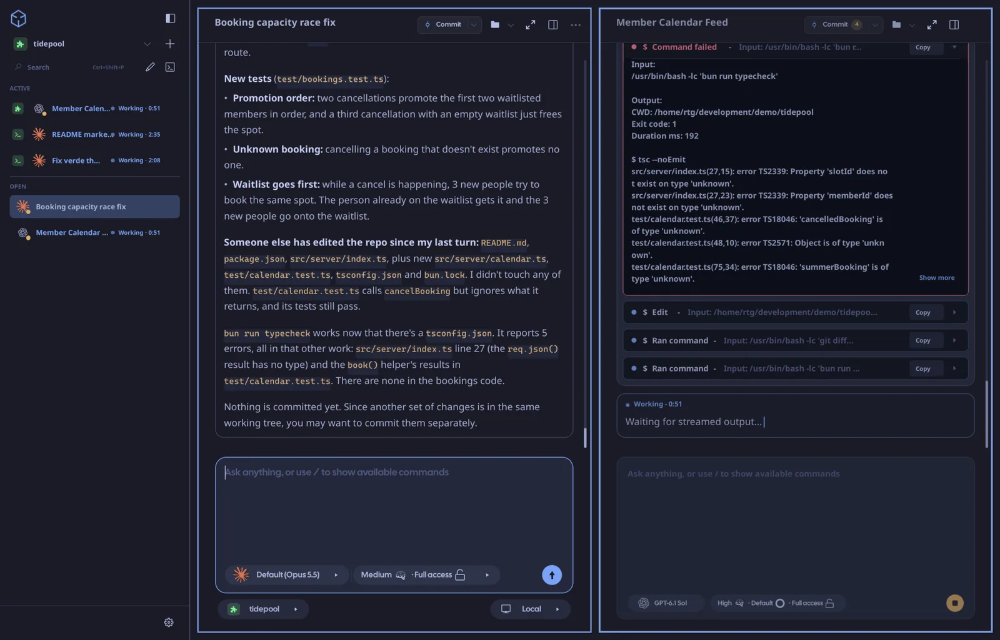
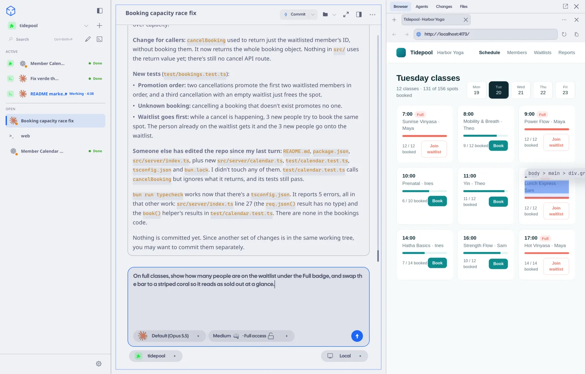
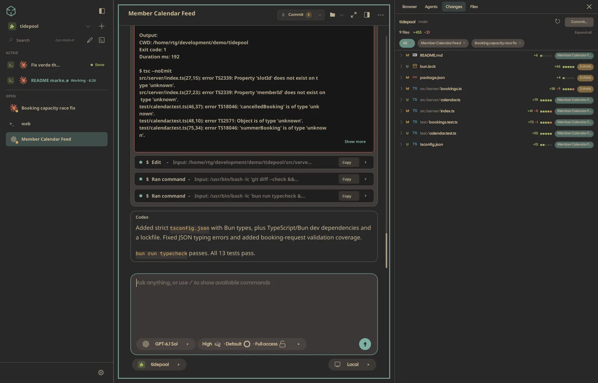
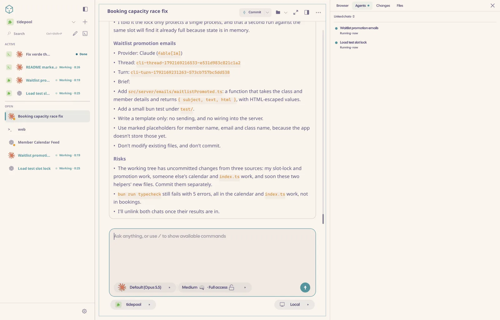
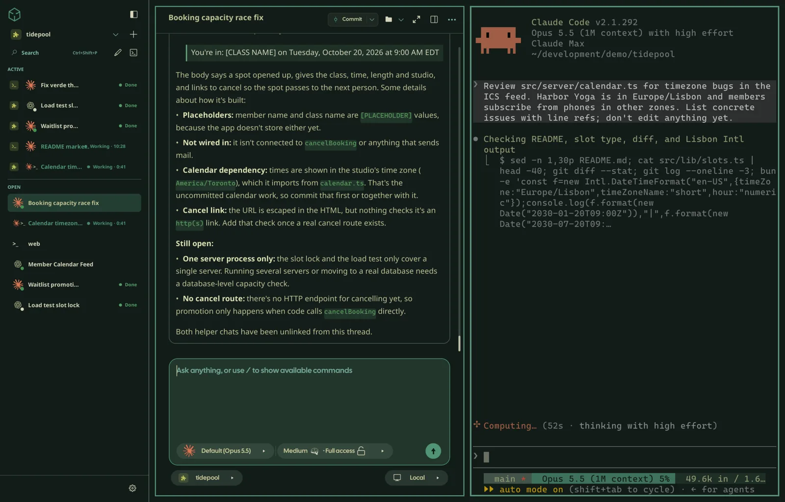
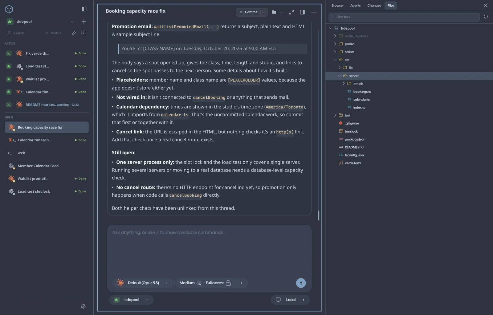

<p align="center">
  
</p>

<h1 align="center">Verde</h1>

<p align="center">
  <strong>Every coding agent. One tiling window.</strong><br />
  Run Codex, Claude Code, Cursor, OpenCode, Grok Build and more side by side.<br />
  Native. Local-first. Free and open source.
</p>

<p align="center">
  <a href="https://verdeai.dev/"><strong>Website</strong></a> ·
  <a href="https://verdeai.dev/docs/quickstart">Quickstart</a> ·
  <a href="https://verdeai.dev/docs">Docs</a> ·
  <a href="https://github.com/JonathanRiche/verde/releases">Download</a> ·
  <a href="LICENSE">MIT</a>
</p>

<p align="center">
  
</p>

<details>
<summary><strong>▶ Watch the 30-second desktop tour (with sound)</strong></summary>

https://github.com/user-attachments/assets/eeb122f2-b175-47f1-8c99-f2553eb651ba

</details>

<table>
  <tr>
    <td width="33%" valign="top">
      <a href="assets/readme/shots/1-tiling.webp"></a>
      <br /><sub><b>Claude and Codex, side by side.</b> Each chat works on its own task in the same repo.</sub>
    </td>
    <td width="33%" valign="top">
      <a href="assets/readme/shots/2-browser.webp"></a>
      <br /><sub><b>Built-in browser.</b> Preview your dev server and point at elements with Design Mode.</sub>
    </td>
    <td width="33%" valign="top">
      <a href="assets/readme/shots/3-changes.webp"></a>
      <br /><sub><b>Changes, per chat.</b> See every changed file and which agent touched it, then commit.</sub>
    </td>
  </tr>
  <tr>
    <td width="33%" valign="top">
      <a href="assets/readme/shots/4-agents.webp"></a>
      <br /><sub><b>Agents that delegate.</b> A chat hands subtasks to helper agents and tracks them live.</sub>
    </td>
    <td width="33%" valign="top">
      <a href="assets/readme/shots/5-terminal-agent.webp"></a>
      <br /><sub><b>CLI agents too.</b> Run Claude Code, Codex and other CLIs in real terminal panes.</sub>
    </td>
    <td width="33%" valign="top">
      <a href="assets/readme/shots/6-files.webp"></a>
      <br /><sub><b>Files at hand.</b> Browse the project tree without leaving the chat.</sub>
    </td>
  </tr>
</table>
<p align="center"><sub>Shown in Tokyo Night, Catppuccin Latte, Gruvbox, Rosé Pine, Osaka Jade and Nord. Verde can follow your Omarchy theme.</sub></p>

<p align="center">
  <code>curl -fsSL https://verdeai.dev/install.sh | sh</code><br />
  <sub>Linux · macOS · Windows: <a href="#install">all install options</a></sub>
</p>

---

## Why Verde

You already pay for Claude, ChatGPT, or Cursor. Verde puts every agent you run into one fast, keyboard-driven workspace. No new subscription, no API keys, and no hosted relay sitting between you and your code.

- **Every agent, side by side.** Codex, Claude Code, OpenCode, Cursor, Pi, FX and Grok Build run as native GUI chats *or* their own TUIs. Amp runs as a TUI.
- **Uses the plans you already have.** Verde drives the provider CLIs on your machine. It does not host models or proxy prompts, and it has no telemetry sink.
- **Approve and steer in place.** Allow a command, redirect a running turn, or queue a follow-up without breaking the agent's flow.
- **A real tiling workspace.** Tile chats, terminals and a browser together, or scroll them as a Niri-style strip. Layouts persist.
- **Point at it, and the agent fixes it.** The built-in browser has Design Mode: click an element or draw a region, and the visual context goes straight to your agent.
- **Agents keep working when you close the window.** A headless session daemon owns every turn and terminal, so work survives restarts and upgrades.
- **Native, not Electron.** Built in Zig on our own GPU UI framework. Idle cost is low, prompt acceptance takes under a millisecond, and long transcripts stream smoothly.

| | Verde | tmux + CLIs | Hosted agent apps | IDE extension |
| --- | :---: | :---: | :---: | :---: |
| Multi-agent tiling | ✓ | ~ | – | ~ |
| Native GUI chat + TUI | ✓ | – | ~ | – |
| Embedded browser + Design Mode | ✓ | – | ~ | – |
| Local-only (no relay) | ✓ | ✓ | – | ~ |
| Phone approval + steering | ✓ | – | ~ | – |
| Scriptable live control | ✓ | ~ | – | – |

✓ full · ~ partial · – not really

---

## Start at your desk. Finish anywhere.

<p align="center">
  
</p>

<details>
<summary><strong>▶ Watch the 30-second mobile tour (with sound)</strong></summary>

https://github.com/user-attachments/assets/6faba933-3e4c-43f5-b733-d6cfa47d423b

</details>

Your agents run on your machines, and the companion apps keep you in the loop when you're away from the desk.

- **Your agent needs you? Approve it in one tap.** Approval requests and finished turns reach your phone.
- **Steer it mid-turn.** It's the same chat with the same context, continued from your pocket.
- **A real terminal and a real diff.** Review changes and push from your phone.
- **Every machine in one app.** Pair your desktop, a home server, or a cloud box, and switch between them in one tap.

The iOS and Android apps are in beta. A browser-based web client is also available. To pair them, see [Serve, Pair, and Connect](docs/serve-pair-connect.md).

---

## Supported agents

| Agent | GUI chat | Terminal TUI | How Verde talks to it |
| --- | :---: | :---: | --- |
| **Codex** | ✓ | ✓ | Local `codex` CLI + `codex app-server` |
| **Claude Code** | ✓ | ✓ | Claude Agent SDK against your installed Claude Code |
| **OpenCode** | ✓ | ✓ | Local `opencode` CLI + `opencode serve` |
| **Cursor** | ✓ | ✓ | Cursor CLI ACP (`agent acp`) |
| **Pi** | ✓ | ✓ | Local `pi` CLI in RPC mode (`pi --mode rpc`) + embedded TUI |
| **FX** | ✓ | ✓ | Local `fx` CLI ACP (`fx acp`) + embedded TUI |
| **Grok Build** | ✓ | ✓ | Local `grok` CLI ACP (`grok agent stdio`) + embedded TUI |
| **Amp** | – | ✓ | Local `amp` CLI in an embedded [Ghostty](https://ghostty.org) pane |

→ Setup notes: [Provider docs](https://verdeai.dev/docs/providers)

---

## Install

**Linux / macOS**

```bash
curl -fsSL https://verdeai.dev/install.sh | sh
```

**Windows x64 (PowerShell)**

```powershell
irm https://verdeai.dev/install.ps1 | iex
```

Or grab a package from [GitHub Releases](https://github.com/JonathanRiche/verde/releases):

| Platform | Artifact |
| --- | --- |
| Linux x86_64 | `verde-v*-linux-x86_64.tar.gz` → extract, run `./install-local.sh` |
| macOS | `.dmg` or `.zip` → move `Verde.app` into Applications |
| Windows x64 | `verde-v*-windows-x86_64.zip` → verify `.sha256`, run packaged `install.ps1` |
| Arch Linux | [`verde-bin`](https://aur.archlinux.org/packages/verde-bin) (`yay -S verde-bin`) |

Windows installs per user (no admin rights needed), adds a Start Menu shortcut, and needs the [WebView2 Evergreen Runtime](https://developer.microsoft.com/microsoft-edge/webview2/). On Linux, the browser pane uses the system's WPE WebKit. The installer warns if those packages are missing; set `VERDE_INSTALL_BROWSER_DEPS=1` to have it install them.

Full install variants and platform notes: [verdeai.dev/#install](https://verdeai.dev/#install) · [Troubleshooting](https://verdeai.dev/docs/troubleshooting)

<details>
<summary><strong>macOS: legacy database repair</strong></summary>

If Verde bounces once in the Dock and does not open with a `DatabaseSchemaTooOld` startup error, quit Verde and run:

```bash
curl -fsSL https://raw.githubusercontent.com/JonathanRiche/verde/master/scripts/repair-legacy-database.sh | sh
```

The repair only updates legacy schema-version-0 databases. It creates a timestamped backup beside `state.sqlite` before using Verde's supported session-daemon migration path; already-migrated databases are left unchanged.

</details>

---

## First five minutes

Verde does **not** ship a model. Install and sign in to at least one provider CLI first:

| Provider | Setup |
| --- | --- |
| **Codex** | [Codex CLI](https://github.com/openai/codex) → `codex login` |
| **Claude Code** | [Claude Code](https://docs.anthropic.com/en/docs/claude-code) + Node on `PATH` → log in |
| **OpenCode** | [OpenCode](https://github.com/anomalyco/opencode) on `PATH` |
| **Cursor** | [Cursor CLI](https://cursor.com/docs/cli/installation) → `agent login` (or `CURSOR_API_KEY`) |
| **Pi** | [pi](https://pi.dev) on `PATH` |
| **FX** | [fx](https://fx.sh) → `fx login` |
| **Grok Build** | [Grok Build](https://docs.x.ai/build/overview#install) → `grok login` |
| **Amp** | [Amp](https://ampcode.com) on `PATH` (terminal TUI) |

Then run `verde`:

1. **Import a project.** Use the sidebar `+`, or right-click the rail. Threads and agents run against that workspace root.
2. **Start a chat.** Click the workspace pencil, or turn on prefix mode and press `Ctrl+B`, then `c`. Pick a provider, a model and run permissions, then send a prompt.
3. **Tile a browser.** Press `Ctrl+Shift+B` to open the native webview (WPE / WKWebView / WebView2).
4. **Open a terminal.** In prefix mode, `Ctrl+B`, then `t` opens a terminal tab, and `Shift+T` opens a standalone pane. Launch the Codex, Claude or Grok TUIs from the palette or with `verde live agent open`.
5. **Jump anywhere.** `Ctrl+Shift+P` opens the command palette, which finds threads, panes, workspaces and app commands.

If no GUI provider is ready yet, Verde shows a **Connect an AI provider** screen that walks you through setup.

→ Full walkthrough: [Quickstart](https://verdeai.dev/docs/quickstart)

---

## Features

<p align="center">
  
</p>

### Tiling workspace, not a chat box

Every pane is first-class. Split a chat beside a browser and drop a terminal next to it. Zoom with `Alt+Z` and rearrange with `Ctrl+Shift+H/J/K/L`. Layouts and per-terminal zoom persist across launches.

### Scrolling pane layout (Niri-style)

With two or more tiled panes, Verde can switch to a horizontal or vertical strip. The strip supports free-form wheel and touchpad panning, resizable columns, sidebar reordering and hover-edge navigation. In **Settings → Workspace** or the command palette, choose Automatic, Always or Disabled. You can also set per-workspace overrides, the direction, and how many panes fit in view.

### Command palette (`Ctrl+Shift+P`)

One Raycast-style launcher ranks threads, open panes, workspaces and commands. `Ctrl+Enter` opens a result in a new pane. Slash commands such as `/stack` and `/process` run from the composer.

### Browser + Design Mode

Tile a native webview next to your agent. Point at an element or draw a region, describe the change, and send the visual context to a chat or a terminal TUI without leaving the workspace.

### Project-scoped terminal dock

Every workspace has its own [Ghostty](https://github.com/ghostty-org/ghostty)-powered terminals, with shell tabs, agent launch profiles, OSC titles, and zoom that stays with the layout.

### Managed processes (`verde.toml`)

Declare dev servers and agents once, then start, stop or restart them from chat or the CLI:

```toml
[processes.web]
command = "npm run dev"
resources = ["port:3000"]

[agents.codex]
provider = "codex"
command = "codex"
revive = "attach_or_create"
hooks = true
```

### Headless session daemon

Chat turns and terminal sessions live in a **session daemon**, not in the window. The GUI, CLI, MCP bridge, web client and mobile apps all attach to it as clients. If you close the window, agent turns keep running and their results are saved. When a new Verde version starts, the daemon finishes its current work and upgrades itself. Drafts, image attachments and transcripts persist across restarts.

### Companion

Turn it on or off in **Settings → Companion**. The companion is a named character (Sprout, Moss or Vireo; you pick it and name it) that orchestrates Verde across every workspace. It hands work off to chats, shows its crew's live status, and gathers everything that needs your approval into one inbox. It runs on whichever connected model you choose, and it follows you to the web and mobile clients.

### Scriptable from your shell

Every running instance exposes local IPC through `verde live`. From hooks, dotfiles or automation, you can inspect panes, open chats, send prompts, steer a running turn, write to terminals and open the browser:

```bash
verde live status --json
verde live chat open --workspace $WS --provider codex --model gpt-6.1-sol --reasoning high
verde live chat send --pane $PANE --prompt "run the tests and fix failures"
verde live chat followup --pane $PANE --prompt "also update the changelog"  # steer the running turn
verde live terminal write --focused --text $'cargo test\r'
verde open http://localhost:3000
```

Agents get the same chat surface over MCP (`verde mcp`). They can open panes, send prompts, read transcripts and queue follow-ups mid-turn. These calls go straight to the daemon, so they never steal focus or touch your composer.

→ Full surface: [CLI reference](https://verdeai.dev/docs/cli)

### Themes that match your rig

On Omarchy, Verde follows the active `colors.toml` automatically. Everywhere else, import portable themes from the site:

```bash
verde theme import https://verdeai.dev/themes/tokyo-night.json
```

<p align="center">
  
  
  
</p>
<p align="center">
  
  
  
</p>

<p align="center">
  <em>Same workspace, different skins. Try them live on <a href="https://verdeai.dev/">verdeai.dev</a>, along with Catppuccin Latte, Matte Black and the Verde default.</em>
</p>

---

## Move around

| Key | Action |
| --- | --- |
| `Ctrl+Shift+P` | Command palette |
| `Ctrl+B`, then `c` | New chat tab (prefix mode) |
| `Ctrl+B`, then `t` | New terminal tab (prefix mode) |
| `Ctrl+B`, then `Shift+T` | New standalone terminal pane (prefix mode) |
| `Ctrl+Shift+B` | Toggle browser pane |
| `Ctrl+Arrow` | Focus panes; `Ctrl+H/J/K/L` remain available as optional `verde.json` bindings |
| `Ctrl+Tab` / `Ctrl+Shift+Tab` | Next / previous pane in sidebar order |
| `Ctrl+Shift+H/J/K/L` | Swap / rearrange panes |
| `Alt+Z` | Zoom focused pane |
| `Alt+1`…`Alt+9` | Jump workspaces |

→ All defaults + remapping: [Keybinds](https://verdeai.dev/docs/keybinds)

---

## Documentation

| Topic | Link |
| --- | --- |
| Quickstart | [docs/quickstart](https://verdeai.dev/docs/quickstart) |
| Providers | [docs/providers](https://verdeai.dev/docs/providers) |
| Chat, models & runs | [docs/chat](https://verdeai.dev/docs/chat) |
| Panes & tiling | [docs/panes](https://verdeai.dev/docs/panes) |
| Design Mode | [docs/design-mode](https://verdeai.dev/docs/design-mode) |
| CLI (`verde live`, state, browser) | [docs/cli](https://verdeai.dev/docs/cli) |
| Config, themes, `verde.toml` | [docs/config](https://verdeai.dev/docs/config) |
| Pairing remote machines + mobile | [Serve, Pair, and Connect](docs/serve-pair-connect.md) |
| Troubleshooting | [docs/troubleshooting](https://verdeai.dev/docs/troubleshooting) |

Agent-friendly crawl: [llms.txt](https://verdeai.dev/llms.txt) · [llms-full.txt](https://verdeai.dev/llms-full.txt) · any page as `/docs/<slug>.md`

### Config cheat sheet

| What | Where |
| --- | --- |
| App state | per-user data dir (`~/.local/share/verde/Native` on Linux) → `state.sqlite` |
| User config | `~/.config/verde/verde.json` (Unix) · `%APPDATA%\Verde\verde.json` (Windows) · override with `VERDE_CONFIG` |
| Project stack | `verde.toml` in the workspace root |
| Logs (Linux) | `~/.local/share/verde/Native/logs/verde.stderr.log` |
| Logs (any) | `verde state path --json` then open `logs/` under that directory |

Example stack and full `verde.json` schema: [Configuration & state](https://verdeai.dev/docs/config)

---

## Under the hood

- **Zig 0.16**: a native executable with no Electron shell.
- **[Palette](packages/palette)**: our in-tree Zig GUI framework. It handles windowing, input, fonts and GPU rendering, with its own Wayland/AppKit/Win32 platform layer and a Vulkan/Metal/Direct3D 11 renderer.
- **Headless session daemon**: owns chat turns and PTYs. The GUI, web gateway, mobile apps, CLI and MCP are all clients, so agent work survives window restarts.
- **[Ghostty](https://github.com/ghostty-org/ghostty) / libghostty-vt**: the embedded terminal engine, pinned to upstream rather than a vendored fork.
- **Native webview**: WPE WebKit, WKWebView or WebView2, with no bundled Chromium.
- **SQLite**: stores local projects, threads, transcripts, drafts and image attachments.

---

## Development

Source builds live in [`packages/desktop/`](packages/desktop). Use [`mise`](https://mise.jdx.dev/) from the repo root (Zig `0.16.0` is pinned in [`mise.toml`](mise.toml)):

```bash
mise install
mise run setup      # install + check build dependencies (Linux uses sudo for WPE WebKit packages)
mise run dev-build  # routine desktop development build
mise run dev        # build + run (native webview)
```

| Task | Command |
| --- | --- |
| Desktop development build | `mise run dev-build` |
| Dev run | `mise run dev` |
| Full build/install | `mise run build` |
| Web client (Zig gateway + Solid SPA) | `mise run web-app` / `mise run web-app-run` |

**Do not use bare `zig build`**: the default Debug + WPE path is known to fail. Use the `mise` tasks above, or pass the flags explicitly:

```bash
zig build dev-build --release=safe -Dbrowser-backend=native_webview
```

For platform notes (WebView2 SDK, WPE packages, macOS codesigning, Windows MSVC), see [Troubleshooting](https://verdeai.dev/docs/troubleshooting) and the comments in [`scripts/`](scripts/). The mobile apps live in [`packages/mobile_ios`](packages/mobile_ios) and [`packages/mobile_android`](packages/mobile_android), and they share [`packages/client_core`](packages/client_core).

---

## Third-party components

Verde is built on the shoulders of these projects. Thank you to their authors and contributors.

| Component | Used for | Upstream | License |
| --- | --- | --- | --- |
| **[Ghostty](https://ghostty.org)** / `libghostty-vt` | The terminal engine behind every terminal pane and agent TUI | [ghostty-org/ghostty](https://github.com/ghostty-org/ghostty) | MIT |
| Claude Agent SDK (`@anthropic-ai/claude-agent-sdk`) | Claude Code provider integration | [anthropics/claude-agent-sdk-typescript](https://github.com/anthropics/claude-agent-sdk-typescript) | [Anthropic terms](https://github.com/anthropics/claude-agent-sdk-typescript/blob/main/LICENSE.md) |
| fff (`fff-c` / `fff-search`) | File indexing and fuzzy search, vendored in [`vendor/fff`](vendor/fff) | [dmtrKovalenko/fff.nvim](https://github.com/dmtrKovalenko/fff.nvim) | MIT |
| zqlite | SQLite bindings for Zig | [karlseguin/zqlite.zig](https://github.com/karlseguin/zqlite.zig) | MIT |
| SQLite | Local state, threads and transcripts | [sqlite.org](https://sqlite.org) | Public domain |
| z-toml | `verde.toml` parsing | [eneskemalergin/z-toml](https://github.com/eneskemalergin/z-toml) | MIT |
| Tree-sitter + JavaScript, TypeScript and JSON grammars | Syntax highlighting, vendored in [`packages/zig_treesitter/vendor`](packages/zig_treesitter/vendor) | [tree-sitter/tree-sitter](https://github.com/tree-sitter/tree-sitter) · [javascript](https://github.com/tree-sitter/tree-sitter-javascript) · [typescript](https://github.com/tree-sitter/tree-sitter-typescript) · [json](https://github.com/tree-sitter/tree-sitter-json) | MIT |
| stb_image | Decoding chat images and browser screenshots ([`vendor/stb_image.h`](vendor/stb_image.h)) | [nothings/stb](https://github.com/nothings/stb) | MIT / public domain |
| Noto Sans, Noto Sans Symbols, Noto Emoji | UI text, symbol and emoji fonts | [notofonts/latin-greek-cyrillic](https://github.com/notofonts/latin-greek-cyrillic) · [notofonts/symbols](https://github.com/notofonts/symbols) · [googlefonts/noto-emoji](https://github.com/googlefonts/noto-emoji) | OFL 1.1 |
| JetBrains Mono | Code and terminal font | [JetBrains/JetBrainsMono](https://github.com/JetBrains/JetBrainsMono) | OFL 1.1 |
| Nerd Fonts (JetBrains Mono Nerd Font, Symbols Nerd Font) | Terminal glyphs and icons | [ryanoasis/nerd-fonts](https://github.com/ryanoasis/nerd-fonts) | MIT (glyph sets keep their own licenses) |
| Codicons | UI icon font | [microsoft/vscode-codicons](https://github.com/microsoft/vscode-codicons) | CC BY 4.0 |
| Cal Sans | Display font | [calcom/font](https://github.com/calcom/font) | OFL 1.1 |

The font license texts ship in [`packages/desktop/src/assets/fonts`](packages/desktop/src/assets/fonts). Palette ([`packages/palette`](packages/palette)), `zig_dif`, `zig_markdown` and `zig_treesitter` are Verde's own in-tree packages.

If you redistribute Verde, keep the relevant upstream notices with the distributed app and vendored source.

---

## License

Verde is licensed under the [MIT License](LICENSE).
